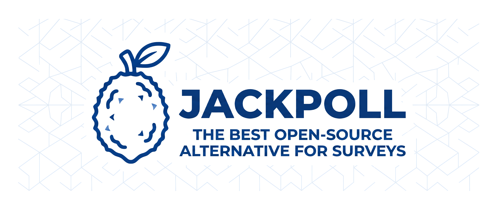

<p align="center">
  
</p>

<p align="center">
  
  
  
</p>

<p align="center"><b>Self-hosting deployment for <a href="https://jackpoll.org">Jackpoll</a> — the open-source tool for building, sharing and analyzing surveys &amp; quizzes.</b></p>

<p align="center">
  <a href="SELF_HOSTING.md"><b>📖 Step-by-step guide</b></a> ·
  <a href="https://github.com/jackpoll-org/jackpoll/tree/main/apps/backend">Backend</a> ·
  <a href="https://github.com/jackpoll-org/jackpoll/tree/main/apps/frontend">Frontend</a>
</p>

---

This repo holds everything needed to run your own Jackpoll instance — Docker
Compose / Swarm stacks, environment templates and the Keycloak realm. **No
application source code**: it pulls the published images from GitHub Container
Registry.

## Quick start (single host)

```bash
git clone https://github.com/jackpoll-org/jackpoll-selfhost.git
cd jackpoll-selfhost
cp .env.simple.example .env          # then edit: replace every CHANGE_ME
docker compose -f docker-compose.simple.yml up -d
```

Open **http://localhost:3000**. Full walkthrough, including going public with
your own domain and TLS, is in **[SELF_HOSTING.md](SELF_HOSTING.md)**.

## Which stack?

| | `docker-compose.simple.yml` | `docker-compose.swarm.yml` |
|---|---|---|
| Orchestrator | plain `docker compose` | Docker Swarm |
| TLS / routing | you add a proxy (or plain HTTP) | Traefik + Let's Encrypt |
| Secrets | `.env` file | external Swarm secrets |
| Scale | single node | multi-replica |
| Best for | trials, small / internal instances | public production |

## What's in the box

| Service | Image | Purpose |
|---|---|---|
| frontend | `ghcr.io/jackpoll-org/frontend` | Next.js web app |
| backend | `ghcr.io/jackpoll-org/backend` | Quarkus REST API |
| postgres | `postgres:16-alpine` | Primary datastore |
| minio | `minio/minio` | File / image uploads (S3) |
| keycloak | `quay.io/keycloak/keycloak:26.2` | Authentication (OIDC) |
| redis | `redis:7-alpine` | Distributed rate limiting |
| mailpit | `axllent/mailpit` | Dev email capture (swap for real SMTP) |
| ntfy | `binwiederhier/ntfy` | UnifiedPush server for mobile push (no Google) |

## Repo layout

```
.
├── docker-compose.simple.yml   # single-host stack (published ports)
├── docker-compose.swarm.yml    # Swarm + Traefik stack (external secrets)
├── .env.simple.example         # config for the simple stack
├── .env.swarm.example          # config for the Swarm stack
├── keycloak/                   # imported realm (synced from the jackpoll backend)
├── docs/assets/                # banner + logo
└── SELF_HOSTING.md             # the full guide
```

> The Keycloak realm's source of truth is the
> [jackpoll monorepo](https://github.com/jackpoll-org/jackpoll/tree/main/apps/backend/src/main/keycloak);
> the copy here is kept in sync by `.github/workflows/sync-realm.yml`.

## License

MIT.
